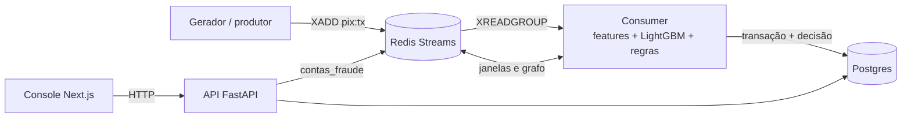

# Sentinela Pix

Detecção de fraude em Pix em tempo real: cada transação recebe score, decisão (aprovar, revisar ou bloquear) e explicação em milissegundos.
Os casos suspeitos caem num console onde o analista investiga, rotula e devolve esse sinal ao sistema. Dados 100% sintéticos.

## Arquitetura



## Como rodar

```bash
make up && make seed && make stream
```

Depois abra http://localhost:3000. O `make seed` gera 2000 contas e 30 dias de histórico, treina o modelo e já deixa casos na fila; o `make stream` publica transações ao vivo por 10 minutos.

Outros alvos: `make test`, `make lint`, `make logs`, `make down`. Para o resumo por LLM, defina `ANTHROPIC_API_KEY` no `.env` (sem a chave, o resumo usa um template determinístico).

## Métricas do modelo

Seed padrão (2000 contas, 30 dias), split temporal 80/20:

| Métrica | Valor |
|---|---|
| Amostras de treino / teste | 139.499 / 34.875 |
| Taxa de fraude no teste | 2,25% |
| PR-AUC | 1,0000 |
| Precisão / recall @ 0,40 | 1,00 / 1,00 |
| Precisão / recall @ 0,85 | 1,00 / 1,00 |

Esses números são perfeitos porque os dados são sintéticos e os padrões de fraude são separáveis por construção; não representam o desempenho em produção. Veja "Limitações de dados sintéticos".

## Decisões técnicas

**Redis Streams vs Kafka.** O projeto precisa de uma fila durável com grupos de consumidores, confirmação de entrega e reprocessamento de pendentes, e o Redis já é obrigatório para o estado das features online. Streams entrega isso com `XADD`, `XREADGROUP` e `XACK` sem um segundo sistema para operar. Kafka passa a valer a pena com particionamento por chave em vários nós, retenção longa para replay e volume muito acima do que uma instância de Redis suporta.

**Consistência online/offline das features.** Há uma única função `calcular_features`, usada no treino e na decisão ao vivo, que depende só da interface `Estado`. `EstadoMemoria` (batch) e `EstadoRedis` (online) implementam essa interface, e um teste verifica que a mesma sequência de 500 transações produz features idênticas nas duas. Isso elimina a divergência entre treino e serving, que é a causa mais comum de um modelo bom no notebook e ruim em produção.

**Split temporal e vazamento.** O corte treino/teste é por tempo (primeiros 80% contra últimos 20%), porque um split aleatório deixaria o modelo ver o futuro de cada conta. As features são lidas do estado antes de a transação ser registrada, então nenhuma inclui a própria transação. O grafo e o conjunto de contas de fraude conhecidas saem apenas da janela de treino, senão `dist_fraude_conhecida` carregaria o rótulo do teste.

**Regras + modelo.** O modelo dá um score contínuo e as regras cobrem o que não deve depender dele: combinações de risco óbvio (dispositivo novo, de madrugada, com valor alto) bloqueiam mesmo com score baixo, e sinais como muitas origens distintas para o mesmo destino mandam para revisão. As regras disparadas entram nos motivos antes da explicação SHAP, de modo que o analista vê por que o caso chegou ali.

**Idempotência.** Streams entrega pelo menos uma vez, então a mesma transação pode chegar de novo após uma falha do consumer. `processar` usa o id da transação como chave: se já existe decisão, devolve a existente sem recalcular nem registrar de novo no estado, o que evita contar a mesma transação duas vezes nas janelas. O `XACK` só acontece depois do commit no banco.

**Feedback loop do analista.** Ao confirmar uma fraude, o destino entra no conjunto `contas_fraude` do Redis. No recálculo periódico do grafo, o consumer usa esse conjunto junto com as fraudes da janela de treino, e as próximas transações perto dessa conta recebem `dist_fraude_conhecida` menor. Os rótulos ficam gravados e alimentam a métrica de precisão da fila; o retreino com eles é manual.

**Limitações de dados sintéticos.** Os três padrões de fraude foram escritos à mão e têm assinaturas nítidas (contas com menos de 30 dias, dispositivo novo de madrugada, muitas origens para um destino), por isso o modelo chega a PR-AUC 1,0. Fraude real é ruidosa, adversarial, muda com o tempo e tem rótulos atrasados e incompletos. O valor do projeto está na arquitetura (streaming, paridade de features, explicabilidade, ciclo do analista), não no número; nada aqui foi validado com dados reais.
